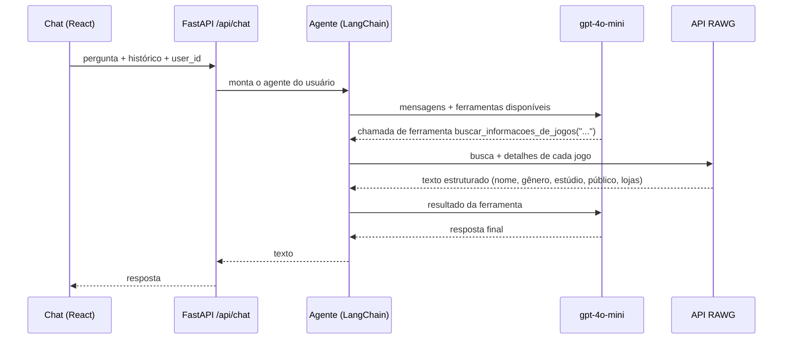

# NetPlay

Assistente de games com **tool calling**: um agente LangChain (OpenAI `gpt-4o-mini`) que decide sozinho quando
buscar dados reais de jogos na [API RAWG](https://rawg.io/apidocs) (lançamento, estúdio, gênero,
classificação etária e lojas), atrás de uma API **FastAPI** e com um chat em **React + TypeScript**.

A ideia de produto por trás é uma economia P2P de mídia física: encontrar perto de você jogos para trocar ou
alugar. Essa parte (Postgres + PostGIS) já tem as ferramentas do agente, mas ainda não tem o esquema do banco
neste repositório. Ela só é ligada quando `DATABASE_URL` está definida.

## Como funciona



- **Tool calling:** o modelo recebe a descrição das ferramentas e escolhe quando chamar. O prompt proíbe
  inventar dados de jogo, e a resposta sai do que a RAWG devolveu.
- **Segurança das ferramentas de banco:** elas são criadas por requisição já presas ao `user_id` do servidor e
  não recebem o id como argumento, então o modelo não consegue consultar outra pessoa trocando o id numa
  chamada. As consultas são parametrizadas.
- **Histórico:** o front manda as últimas mensagens, e a API usa as 10 mais recentes.

## Como rodar

Backend (Python 3.12+, com [uv](https://docs.astral.sh/uv/)):

```bash
cd backend
cp .env.example .env               # preencha OPENAI_API_KEY e RAWG_API_KEY
uv sync
uv run uvicorn src.main:app --reload       # API em http://127.0.0.1:8000 (docs em /docs)
uv run python -m src.cli                   # ou converse pelo terminal
```

Frontend (Node 22):

```bash
cd frontend
npm ci
npm run dev                        # http://localhost:5173
```

## Testes

```bash
cd backend && uv run --group dev python -m unittest discover -s tests -t . -v
cd frontend && npm run lint && npm run build
```

Os testes do backend rodam sem rede e sem chaves de API:
- a RAWG é simulada, para conferir o texto estruturado e os erros;
- o banco é simulado, para conferir que a consulta usa o usuário certo e que a ferramenta não recebe `user_id`;
- um modelo falso que chama ferramentas passa pelo agente de verdade (`create_agent`), da chamada da ferramenta
  até a resposta final;
- a API é testada com o `TestClient` do FastAPI.

O CI roda os testes e o build do front a cada push.

## Estrutura

```text
backend/src/
  main.py               app FastAPI, CORS
  api/chat_routes.py    POST /api/chat
  agents/game_agent.py  prompt, ferramentas e create_agent
  tools/game_tools.py   ferramenta da RAWG
  tools/database_tools.py  ferramentas P2P (opcionais)
  rawg.py               cliente da API RAWG
  cli.py                chat no terminal
frontend/src/           chat em React
```

## Histórico

A primeira versão (maio de 2026) usava `create_tool_calling_agent` e `AgentExecutor`, que saíram do pacote
`langchain` na versão 1.x. Com as dependências atuais, o backend não iniciava. A revisão de novembro de 2026:

- migrou o agente para `create_agent`;
- corrigiu os imports (a rota chamava uma função inexistente, e o agente importava a ferramenta do arquivo
  errado);
- corrigiu a consulta de jogos próximos, que ignorava o usuário (usava um id fixo) e passava parâmetros que a
  SQL não tinha;
- prendeu as ferramentas de banco ao usuário no servidor;
- tirou um prompt duplicado sem uso, o script de terminal duplicado e o `egg-info` versionado;
- restringiu o CORS e acrescentou o histórico da conversa, os testes e o CI.

## Créditos

Feito em dupla por Diogo Medeiros ([GitHub](https://github.com/ddmdros)) e Stephanie Pinho
([GitHub](https://github.com/stephanielumertz), [LinkedIn](https://www.linkedin.com/in/stephanielumertz/)).
A revisão de novembro de 2026 (migração, correções, testes e CI) veio depois.
