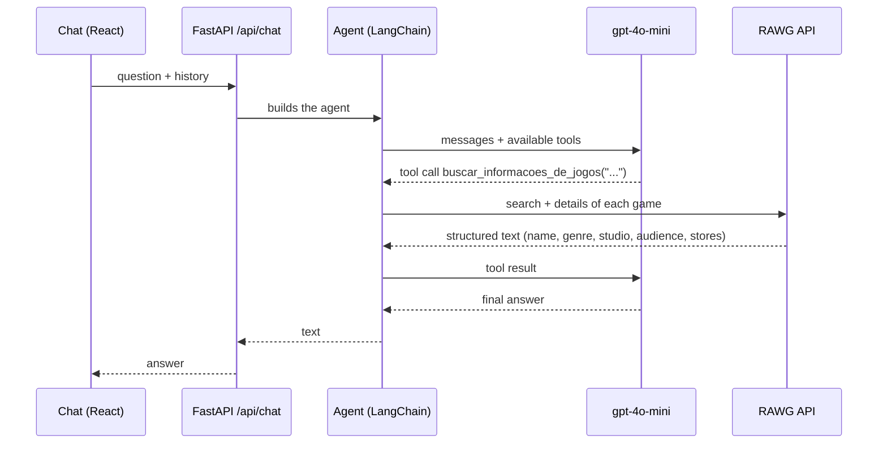

# NetPlay

A games assistant with **tool calling**: a LangChain agent (OpenAI `gpt-4o-mini`) that decides on its own when to
fetch real game data from the [RAWG API](https://rawg.io/apidocs) (release date, studio, genre, age rating and
stores), behind a **FastAPI** API and with a chat in **React + TypeScript**.

The product idea behind it is a P2P marketplace for physical game media. This repository holds only the part that
works today, the games assistant; the marketplace is listed under [Next steps](#next-steps).

## How it works



- **Tool calling:** the model receives the tools' descriptions and chooses when to call them. The prompt forbids
  making up game data, and the answer comes from what RAWG returned.
- **History:** the front end sends the latest messages, and the API uses the 10 most recent.

## Running it

Backend (Python 3.12+, with [uv](https://docs.astral.sh/uv/)):

```bash
cd backend
cp .env.example .env               # fill in OPENAI_API_KEY and RAWG_API_KEY
uv sync
uv run uvicorn src.main:app --reload       # API at http://127.0.0.1:8000 (docs at /docs)
uv run python -m src.cli                   # or chat from the terminal
```

Frontend (Node 22):

```bash
cd frontend
npm ci
npm run dev                        # http://localhost:5173
```

## Tests

```bash
cd backend && uv run --group dev python -m unittest discover -s tests -t . -v
cd frontend && npm run lint && npm run build
```

The backend tests run with no network and no API keys:
- RAWG is mocked, to check the structured text and the errors;
- a fake model that calls tools goes through the real agent (`create_agent`), from the tool call to the final
  answer;
- the API is tested with FastAPI's `TestClient`.

CI runs the tests and the front-end build on every push.

## Structure

```text
backend/src/
  main.py               FastAPI app, CORS
  api/chat_routes.py    POST /api/chat
  agents/game_agent.py  prompt, tools and create_agent
  tools/game_tools.py   RAWG tool
  rawg.py               RAWG API client
  cli.py                terminal chat
frontend/src/           React chat
```

## History

The first version (May 2026) used `create_tool_calling_agent` and `AgentExecutor`, which were removed from the
`langchain` package in version 1.x. With current dependencies, the backend did not start. The November 2026
revision:

- migrated the agent to `create_agent`;
- fixed the imports (the route called a function that did not exist, and the agent imported the tool from the
  wrong file);
- removed the unfinished marketplace tools: their database schema was never in the repository (the code is in the
  git history, and the plan is under Next steps);
- removed an unused duplicate prompt, the duplicate terminal script and the committed `egg-info`;
- restricted CORS and added the conversation history, the tests and CI.

## Next steps

The P2P marketplace for physical media, as designed:

- **Database:** Postgres with PostGIS for users, inventory, wishlists and transactions, with the schema and
  migrations versioned in the repository.
- **Location tools for the agent:** find copies for trade or rent within a radius of the user, and read the user's
  own account. The tools are bound to the logged-in user on the server and do not take a user id, so the model
  cannot query another person.
- **Login,** so the API knows who the user is.
- **Semantic search** over the game catalog with pgvector.
- **Human approval** before any action that changes data (a trade request, a profile update).
- **Long conversations:** summarize older messages and keep the last few intact.

## Credits

Built as a pair by Diogo Medeiros ([GitHub](https://github.com/ddmdros)) and Stephanie Pinho
([GitHub](https://github.com/stephanielumertz), [LinkedIn](https://www.linkedin.com/in/stephanielumertz/)).
The November 2026 revision (migration, fixes, tests and CI) came later.
